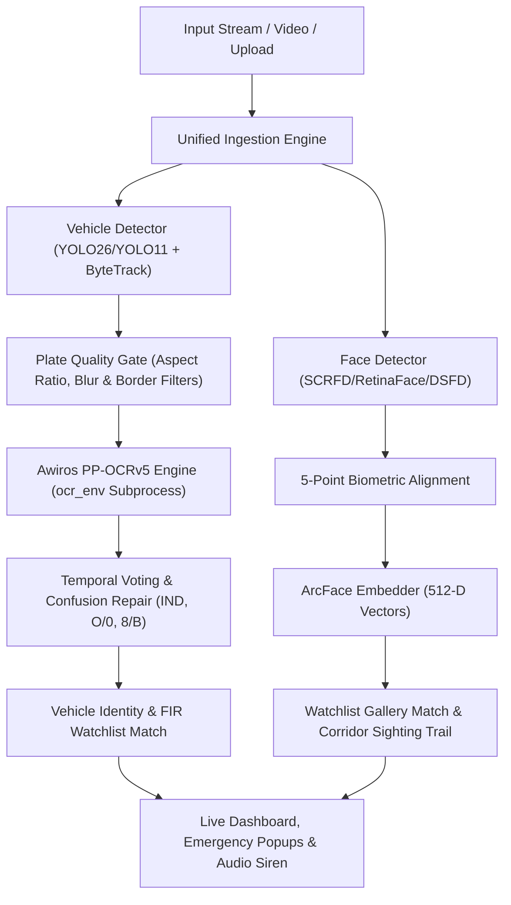

# ANPR vehicle surveillance

This local build provides vehicle and number plate recognition, Karnal camera locations and vehicle trails. Facial recognition processing and its application screens/APIs have been removed. The interface uses a light theme and searchable camera dropdowns. Existing historical data files are preserved.

# Smart Unified Surveillance & Forensic Intelligence System (ANPR & FRS)

> **Official Portal — State Police Headquarters, Haryana**  
> Enterprise-grade Dual-Modality Surveillance Platform combining **Automated Number Plate Recognition (ANPR)** and **Deep Facial Recognition System (FRS)** with multi-camera stream synchronization, vehicle identity tracking above ByteTrack, hardware benchmark profiling, and state-wide Master DB registry.

---

## 🌟 System Overview & Core Capabilities

The Smart Unified Surveillance & Forensic Intelligence platform addresses real-world traffic and investigative edge conditions through an integrated multi-tiered AI pipeline:

1. **Dual-Modality Processing**: Concurrent real-time execution of vehicle identity recognition (ANPR) and facial identification (FRS) over live RTSP streams, multi-camera simulated feeds, and forensic video/photo uploads.
2. **Vehicle Identity Layer (Above ByteTrack)**: Eliminates duplicate detections, tracks vehicles across camera occlusions, and aggregates optical OCR votes to establish unified vehicular profiles.
3. **Multi-Architecture Model Catalog**: Hot-swappable detector and embedder backbones allowing operators to switch between high-speed edge inference and deep forensic analysis.
4. **Hardware Benchmark Profiler & Advisor**: Benchmarks your system's CPU/GPU performance and automatically recommends the optimal model combination:
   - ⚡ **High FPS Mode (Live Edge)**: Ultra-fast processing for high-density traffic.
   - ⚖️ **Balanced Mode (Standard Duty)**: Optimum blend of accuracy and throughput.
   - 🔬 **Accurate Mode (Forensics)**: Maximum parameter models for complex nighttime/high-grain forensic audits.
5. **Master DB Registry & Sighting Corridor Trail**: High-density compact card interface managing registered vehicle watchlists, criminal FIR records, enrolled suspect faces, and multi-camera temporal timelines.
6. **Role-Based Access Control (RBAC)**: PBKDF2 cryptographic authentication with strict role segregation (`STATE_ADMIN`, `DISTRICT_ADMIN`, `OPERATOR`).
7. **Optional Annotated Video Generation**: Operator toggle to generate full annotated evidentiary videos or run in 2× faster metadata-only mode.

---

## 🧠 Configured Deep Learning Models

### 1. ANPR Engine (Vehicle & License Plate)

| Component | Models Available | Format / Checkpoint | Primary Use Case |
| :--- | :--- | :--- | :--- |
| **Vehicle Detection** | **YOLO26 Series** (`yolo26n`, `yolo26s`, `yolo26m`, `yolo26l`, `yolo26x`)<br>**YOLO11 Series** (`yolo11n`, `yolo11s`, `yolo11m`, `yolo11l`, `yolo11x`) | PyTorch (`.pt`) & OpenVINO IR | Multi-class vehicle localization & bounding box tracking |
| **Plate Detection** | **YOLO11-ALPR** (`yolo11_plate.pt`, `yolo11s_plate.pt`)<br>**YOLO26-ALPR** (`yolo26_plate.pt`)<br>**Indian Plate SOTA** (`indian_plate_yolo.pt`)<br>**YOLOv8 ALPR** (`yolov8_plate.pt`) | PyTorch (`.pt`) & OpenVINO IR | High-recall localization of standard Indian & HSRP plates |
| **Optical Character Recognition (OCR)** | **PP-OCRv4 Server** (Ultra-fast server model <100MB)<br>**Awiros ANPR** (`model.safetensors`, 37.3M Params) | ONNX / SafeTensors + CTC | Direct synchronous OCR execution (zero queue lag), HSRP "IND" strip removal, 2-line parsing, optical confusion repair |

### 2. FRS Engine (Facial Recognition System)

| Component | Models Available | Checkpoint Size | Primary Use Case |
| :--- | :--- | :--- | :--- |
| **Face Detectors** | **SCRFD-10G** (`scrfd_10g_bnkps.onnx`)<br>**RetinaFace ResNet-50** (`retinaface_resnet50.onnx`)<br>**DSFD ResNet-152** (`dsfd_resnet152.pth`) | 16.1 MB<br>104.4 MB<br>458.7 MB | 5-point landmark alignment, unconstrained angles, dense crowd forensics |
| **Face Embedders** | **ArcFace iResNet-100** (`arcface_iresnet100.onnx`)<br>**ArcFace iResNet-50** (`arcface_iresnet50.onnx`)<br>**ArcFace ResNet-34** (`arcface_r34.onnx`) | 248.6 MB<br>166.3 MB<br>130.3 MB | 512-D normalized biometric vectors; Cosine & Euclidean similarity matching |

---

## 🚀 Key Pipeline Innovations



### 1. Pre-OCR Crop Quality Gate
- **Laplacian Blur Rejection**: Filters out motion-blurred crops ($Var(\nabla^2 I) < 45.0$).
- **Indian Aspect Ratio Constraints**: Validates standard vehicle plate proportions ($1.2 \le W/H \le 5.5$).
- **Watermark & Timestamp Masking**: Ignores camera timestamps, overlays, and edge border artifacts.

### 2. Contextual Indian Plate Repair & HSRP Normalizer
- Supports **Standard Indian formats** (`HR 26 DK 8337`, `DL 1C AA 1111`) and **Bharat Series** (`22 BH 1234 AA`).
- Position-based character confusion repair (e.g. `O`/`0`, `I`/`1`, `8`/`B`, `5`/`S`, `Z`/`2`).
- Strips blue **HSRP "IND"** identifier bands.

### 3. Confidence-Weighted Temporal Voting
- Aggregates multi-frame candidate OCR readings across tracks.
- Promotes to Verified Results only if:
  - Backed by $\ge 3$ candidate detections
  - Achieves composite confidence $\ge 68\%$
  - Conforms to valid Indian RTO regular expressions
- Unresolved or partial reads are routed to a dedicated **"Needs Review"** queue.

### 4. Zero-Queue Direct Synchronous OCR Execution
- Eliminates asynchronous background worker queues (`async_ocr=False`).
- Once a detected plate passes quality gate checks, OCR runs immediately in-line within the frame inference cycle, eliminating buffer latency between video detection and database persistence.
- Complete architectural lifecycle and timing flow is detailed in [Pipeline Architecture & Technical Reference](docs/PIPELINE_ARCHITECTURE.md).

### 5. Mobile & Field Responsive Ergonomics
- Fully responsive interface optimized for field smartphones (375px–390px viewports):
  - Touch-activated navigation drawer with backdrop overlay.
  - Multi-row structured capture cards (0px horizontal overflow, eliminating sliding).
  - Swipeable hardware recommendation carousel in System Benchmark.

---

## 🛠️ Automated Model Weights Downloader

The project includes an automated downloader script (`scripts/download_models.py`) designed to manage large deep-learning models (>100 MB) that exceed GitHub's native file size limit.

### Features:
- **Zero-Setup Execution**: Automatically detects models existing on disk and skips re-downloading.
- **Multi-Source Resilience**:
  - Automatically fetches release assets from GitHub Releases (`v1.0-weights`) when authenticated.
  - Automatically falls back to high-speed public mirrors (**Hugging Face Hub** & **Google Drive**) if run without a GitHub token.

### Usage:
```bash
# Automated verification & download
python scripts/download_models.py

# Force re-download / refresh all weights
python scripts/download_models.py --force
```

---

## 📁 Repository Directory Structure

```text
projext/
├── app.py                         # FastAPI backend REST API & real-time surveillance server
├── config.py                      # Global configuration, model paths & pipeline hyperparameters
├── run_tests.py                   # Automated test runner suite
├── requirements.txt               # Main Python dependencies
├── start.bat                      # Windows batch startup launcher
├── start.ps1                      # Windows PowerShell startup launcher
├── start.sh                       # Linux native Python startup script (auto-detects venv & uvicorn)
├── stop.sh                        # Native Python graceful shutdown script
├── docs/
│   └── PIPELINE_ARCHITECTURE.md   # Comprehensive pipeline lifecycle & technical specification
├── scripts/
│   └── download_models.py         # Automated deep weights downloader with HuggingFace/Drive fallbacks
├── src/
│   ├── detection/
│   │   ├── model_registry.py      # Dynamic model catalog, active model state & hardware selection
│   │   ├── vehicle_detector.py    # YOLO vehicle detection & ByteTrack association
│   │   └── plate_detector.py      # License plate detector & morphological extractor
│   ├── ocr/
│   │   ├── awiros_engine.py       # High-throughput PP-OCRv5 inference engine
│   │   ├── awiros_worker.py       # Subprocess worker communicating with Python 3.11 environment
│   │   ├── normalizer.py          # Indian plate format normalizer & contextual repair
│   │   └── ocr_engine.py          # EasyOCR multi-pass fallback wrapper
│   ├── identity/
│   │   ├── vehicle_identity.py    # VehicleRecord data structures & track states
│   │   ├── track_merger.py        # Spatio-temporal track continuity & merging
│   │   └── temporal_voting.py     # Multi-frame voting & plate deduplication
│   ├── benchmarks/
│   │   └── benchmark_service.py   # Hardware profiler, FPS benchmark & mode recommendation engine
│   ├── camera/
│   │   └── stream_manager.py      # Multi-camera RTSP ingestion & simulation loops
│   ├── database/
│   │   ├── auth_db.py             # User accounts & PBKDF2 session management
│   │   ├── vehicle_db.py          # Watchlist vehicles & FIR case records
│   │   ├── captured_db.py         # Capture history & evidence scene crops
│   │   ├── trail_db.py            # Corridor sightings & camera timeline
│   │   └── audit_db.py            # Administrative changes audit logging
│   ├── frs/
│   │   ├── detection/             # Face detectors (SCRFD-10G, RetinaFace-R50, DSFD-R152)
│   │   ├── recognition/           # Face embedders (ArcFace iResNet-50, iResNet-100, ResNet-34)
│   │   ├── pipeline/              # End-to-end FRS pipeline orchestration
│   │   └── database/              # Enrolled identities, face sightings & corridor trail
│   └── pipeline/
│       ├── anpr_pipeline.py       # Full ANPR workflow pipeline
│       └── unified_pipeline.py    # Dual ANPR + FRS synchronized pipeline
├── static/
│   ├── index.html                 # Unified surveillance dashboard & Master DB views
│   ├── login.html                 # Police portal authentication portal
│   ├── app.js                     # Frontend logic, charts, modals & real-time updates
│   └── styles.css                 # Dark tactical theme & HSRP plate components
├── models/
│   ├── yolo/                      # YOLO vehicle & license plate weights
│   ├── frs/                       # Face detection & ArcFace embedding checkpoints
│   └── awiros_anpr/               # Awiros PP-OCRv5 SafeTensors weights
├── data/                          # SQLite operational databases & evidence photo crops
└── outputs/                       # Evidentiary video exports, demo loops & doc assets
```

---

## ⚙️ Installation & Setup

### 1. Clone the Repository
```bash
git clone https://github.com/haryana-police/anpr-frs.git
cd anpr-frs
```

### 2. Environment Setup
Install required system packages and Python dependencies:
```bash
pip install -r requirements.txt
```

> [!NOTE] Dedicated OCR Environment
> PaddlePaddle and the Awiros PP-OCRv5 worker operate inside a dedicated Python 3.11 virtual environment (`ocr_env/venv/`) configured to support specialized OCR operations without wheel conflicts.

### 3. Verify & Download Deep AI Models
Run the automated model downloader to retrieve any missing heavy weights:
```bash
python scripts/download_models.py
```

### 4. Run the Application
Launch the surveillance server:

**Windows (PowerShell or Batch):**
```powershell
.\start.ps1
# or
.\start.bat
```

**Direct Python CLI:**
```bash
python app.py
```

The portal will initialize at:
👉 **`http://localhost:8000`**

---

## 🔐 Default Administrative Credentials

The portal features role-based access control with pre-seeded administrative accounts for system operation:

| Role | Username | Password | Operational Scope |
| :--- | :--- | :--- | :--- |
| **State Admin** | `stateadmin` | `HaryanaPolice@HQ2026` | Statewide access, system audit, user creation, model configuration |
| **District Admin** | `admin_panipat` | `PanipatAdmin@2026` | District-locked oversight (Panipat), operator management |
| **Duty Operator** | `op_5421` | `Operator@123` | Live surveillance, watchlist query, field identity enrollment |

---

## 🧪 Testing & Verification

Run the comprehensive unit test suite:
```bash
python run_tests.py
```

The automated test runner validates:
- Pre-OCR crop quality filtering & aspect ratio geometry
- Indian license plate normalization & character confusion matrix
- Multi-camera track merging & cross-frame continuity
- Confidence-weighted temporal voting algorithms
- End-to-end ANPR & FRS simulation pipelines
- REST API endpoints and database integrity

---

## 📜 License & Compliance

Developed for the **Haryana Police Department**. Proprietary & confidential surveillance intelligence system. Unauthorized duplication, modification, or distribution is strictly prohibited under applicable digital laws.
