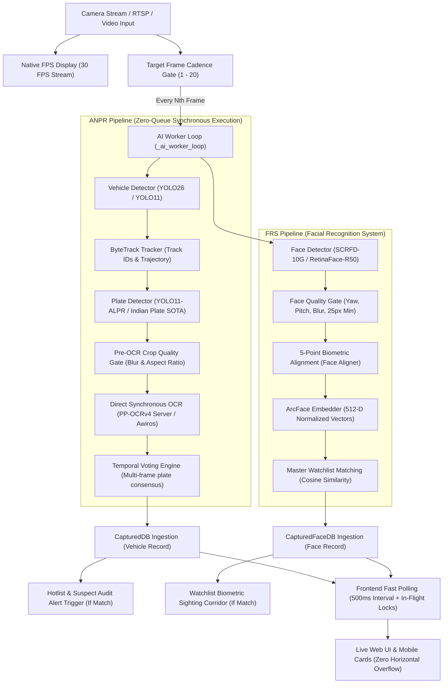

# ANPR & FRS Pipeline Architecture & Technical Reference

> **Official Technical Specification — State Police Headquarters, Haryana**  
> *Last Updated: October 2026 (Reflecting Synchronous OCR Execution & Mobile UI Overhaul)*

---

## 1. End-to-End Pipeline Execution Lifecycle



---

## 2. Key Architectural Decisions & Optimizations

### 2.1 Synchronous OCR Execution (Commit `3d16c80`)
- **Previous Architecture**: Frames with detected plates were placed into an asynchronous worker queue (`async_ocr=True`, `max_ocr_queue_size=64`). During high-FPS video streams or burst traffic, frames queued up, causing significant latency between plate passage and database capture.
- **Current Architecture**: Replaced with **Direct Synchronous OCR** (`async_ocr=False`). When a candidate plate crop passes the quality gate, OCR is executed immediately in the AI worker loop for that frame. No frames are queued, eliminating queue lag and memory bloating.

### 2.2 Real-Time UI Synchronization & Low Latency (500ms)
Operators observe bounding boxes immediately on video frames as detections occur. Database and feed synchronization is optimized to follow almost instantaneously:
1. **Visual Bounding Box (30 FPS Stream)**: Bounding boxes are drawn onto active MJPEG video frames directly by YOLO/RetinaFace in the AI rendering loop (~33ms/frame).
2. **Quality Gate & Verification**: A vehicle or face is committed to the database as soon as it satisfies the anti-garbage quality gate (`final_confidence >= 40%`, non-blurry, readable characters).
3. **High-Frequency Frontend Sync (500ms)**: The web UI polls the unified live feed, drawer lists, and active alerts every **500ms** (reduced from 1.5s–2.0s). In-flight request guards (`isFetchingUnifiedLiveFeed`, `isPollingCameraStatuses`, `isFetchingActiveAlerts`) prevent concurrency stacking and browser network queue starvation.
4. **Instant Dual-Pipeline Reflection**: Active camera status polling checks both ANPR and FRS streams (`anpr_enabled || frs_enabled`), ensuring newly captured vehicles and faces reflect simultaneously in both live activity cards and database drawers.

### 2.3 Configurable Target Frame Cadence (1–20)
- The system decouples visual rendering from AI inference.
- Operators can configure the **Target Frame** parameter (from 1 to 20):
  - **Cadence = 1**: Every single frame is sent to AI models (highest load, maximum inference density).
  - **Cadence = 5 (Default)**: AI runs every 5th frame (~6 FPS inference) while the video stream plays smoothly at full 30 FPS.
  - **Cadence = 10–20**: Edge/lightweight mode for resource-constrained multi-core CPUs.

### 2.4 Active Model Catalog
| Modality | Standard Active Model | Format / Weight | Purpose |
| :--- | :--- | :--- | :--- |
| **Vehicle Detection** | **YOLO11 / YOLO26** | `.pt` / OpenVINO IR | Multi-class vehicle tracking & bounding box coordinates |
| **Plate Detection** | **YOLO11s-Plate / Indian SOTA** | `.pt` | High-recall localization of Indian & HSRP plates |
| **OCR Engine** | **PP-OCRv4 Server** & **Awiros ANPR** | SafeTensors / ONNX (<100MB) | HSRP "IND" stripping, multi-line parsing & confusion repair |
| **Face Detection** | **SCRFD-10G** | ONNX (16.1 MB) | 5-point facial landmark alignment & rapid localization |
| **Face Recognition** | **ArcFace ResNet-34 / iResNet-50** | ONNX (130 MB - 166 MB) | 512-dimensional biometric embedding extraction |

### 2.5 Selective Modality Execution in Upload & Analysis Hub
Operators can isolate investigations to specific modalities using the detection target switcher:
1. **Vehicle Only (`target=vehicle`)**:
   - Executes ANPR pipeline only (YOLO vehicle detection, plate localization, PP-OCRv4/Awiros OCR).
   - Completely bypasses SCRFD face detection and ArcFace biometric extraction.
   - Output annotated video strictly renders vehicle boxes, plate tags, and OCR readings with no face boxes or landmarks.
   - Logs records strictly to `CapturedDB` (no records or alerts generated in `CapturedFaceDB`).
2. **Face Only (`target=face`)**:
   - Executes FRS biometric pipeline only (SCRFD face detection, 5-point facial landmark alignment, ArcFace feature extraction).
   - Completely bypasses YOLO vehicle detector, plate localization, and OCR engine.
   - Output annotated video strictly renders facial bounding boxes, identity tags, and 5-point landmarks with no vehicle or plate overlays.
   - Logs records strictly to `CapturedFaceDB` (no records or alerts generated in `CapturedDB`).
3. **Vehicle & Face (`target=both`, Default)**:
   - Executes full multi-modal pipeline with spatial cross-modal occupant-to-vehicle correlation and dual-column inspection reporting.

---

## 3. Mobile UI & Responsive Ergonomics

Optimized for Haryana Police field personnel and administrators using mobile devices (375px–390px viewports):

1. **Navigation Drawer**: Dedicated hamburger toggle with touch backdrop overlay (`#mobileSidebarBackdrop`) and auto-close upon tab selection.
2. **Responsive Capture Cards**: Multi-row mobile cards (`.captured-list-row`) replacing horizontal flex layouts:
   - **Row 1**: Rank badge (`#1`), high-resolution thumbnail crop, plate/name, and verified badge.
   - **Row 2**: Camera location and timestamp.
   - **Row 3**: Confidence pill, full-width touch-friendly **Inspect** button, and action controls.
   - **Horizontal Overflow**: Guaranteed `0px` across all screen sizes.
3. **System Benchmark Carousel**: The 3-profile advisor (`High Speed`, `Balanced`, `High Accuracy`) converts from a 3-column desktop grid into a horizontal swipeable carousel (`scroll-snap-type: x mandatory`).
4. **Scope Filters (District / Operator)**: Automatically stack vertically on mobile with `text-overflow: ellipsis` to cleanly handle long administrative titles.

---

## 4. Operational Commands & Startup

### Windows Native (Recommended):
```powershell
# Quick Start via PowerShell
.\start.ps1

# Quick Start via Batch
.\start.bat

# Direct CLI launch
.\.venv\Scripts\python.exe -m uvicorn app:app --host 0.0.0.0 --port 8000
```

### Linux / Server Deployment:
```bash
bash start.sh
```

---

## 5. Maintenance & Documentation Protocol
> [!IMPORTANT] Documentation Integrity Rule
> Any future modifications to pipeline execution parameters, model weights, database schemas, or frontend sync intervals MUST be cross-documented in this file and `README.md` in the same commit to maintain alignment between system reality and operational documentation.
